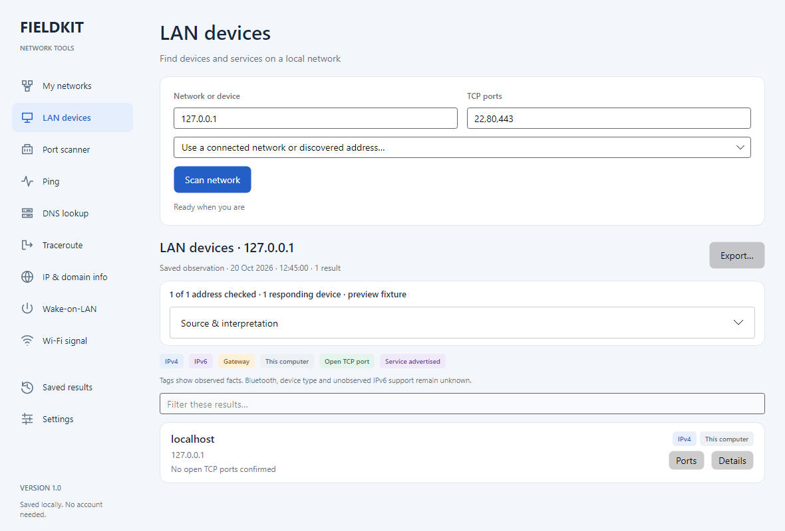

# FieldKit Network Analyzer

An everyday network toolkit for Android, iPhone/iPad, Windows and Linux. FieldKit shows separate network interfaces, suggests connected networks as tool targets, and keeps timestamped results across navigation and app restarts. Light, dark and system themes are included.

[Downloads](https://github.com/ange10fcode/fieldkit-network-analyzer/releases) · [Build from source](docs/BUILDING.md) · [Privacy](PRIVACY.md) · [Release notes](docs/RELEASE-NOTES-1.0.0.md)

## Install 1.0

| Platform | Package | Requirements |
| --- | --- | --- |
| Android | `FieldKit-1.0.0-Android.apk` | Android 8.0/API 26 or later. Optional radio features need compatible hardware and permissions. |
| Windows | `FieldKit-1.0.0-Windows-x64.zip` | Windows 10 22H2 or Windows 11, x64. Extract the whole folder and run `FieldKit.exe`. |
| Linux | `FieldKit-1.0.0-Linux-x64.tar.gz` | x64 desktop with X11/XWayland and the [desktop dependencies](desktop/README.md). Extract and run `./FieldKit`. |
| iOS | Simulator app and **unsigned** Xcode archive | iOS 16 or later. Physical iPhone/iPad installation requires Apple signing; the archive is not an installable IPA. See [iOS instructions](ios/README.md). |

Desktop packages include their .NET runtime. Windows executables are not Authenticode signed. Checksums accompany release downloads. Source and build workflows are public under the MIT license; dependency licenses are retained separately.

The public Android release uses a new signing identity. Export wanted results from a private prototype before uninstalling it and installing 1.0. Android cannot update that prototype in place with a different signing key. Future official Android releases must retain the new release key.

## Tools and platform support

| Capability | Android | Windows / Linux | iOS |
| --- | --- | --- | --- |
| Separate Wi-Fi, cellular, VPN/tunnel and Ethernet inventory | As exposed by Android | As exposed by the OS | Addresses per interface; type inferred and labeled |
| Suggested targets, manual IPv4 LAN ranges, TCP ports | Yes | Yes | Yes |
| Device names and services | PTR, mDNS/Bonjour, SSDP where published | PTR and SSDP/UPnP where published | PTR and Bonjour where published |
| IPv4/IPv6 inventory, observed tags and legend | Yes | Yes | Yes |
| Ping / connection timing | ICMP and labeled TCP fallback | ICMP and labeled TCP fallback | TCP connection timing |
| DNS and registration information | Yes | Yes | System DNS and RDAP |
| Traceroute | Within Android restrictions | OS `tracert` / `traceroute` | Unavailable in this release |
| Wake-on-LAN | Yes | Yes | UDP send; broadcast may need an Apple entitlement |
| Wi-Fi observations | Surveys and signal with permissions | OS snapshots; NetworkManager on Linux | General surveys unavailable through public iOS APIs |
| BLE discovery and signal history | Yes | Unavailable in desktop 1.0 | Yes |
| Wi-Fi RTT distance | Compatible phone and access point | Unavailable | Unavailable |
| Precision distance / direction | Android UWB peer pairing | Unavailable | Nearby Interaction between compatible FieldKit iPhones |
| Retained results, local history, themes | Yes | Yes | Yes |

Names depend on what devices advertise or publish in DNS. Devices that ignore probes may not appear. Color tags show observed facts, without guessing Bluetooth identities or merging IPv4/IPv6 identities. Results keep their original timestamps and do not imply continuous monitoring. VPN and OS routing policies still apply, including with a selected source interface.

Precision finding checks support before pairing. It needs supported hardware and a compatible cooperating peer. FieldKit does not connect to AirTags, SmartTags, Apple's Find My network or Google's tracking network. Android and iOS precision-finder protocols are separate. A compass or an IP address alone cannot provide a target bearing. BLE history shows stronger/weaker observations without inventing a distance.

## Development

The repository contains native Android Java, native iOS SwiftUI, and a Windows/Linux Avalonia app with a shared .NET core. There is no FieldKit account, analytics service or cloud inventory backend. Tools contact requested targets/resolvers; registration lookups contact RDAP services. See [privacy details](PRIVACY.md).

```text
android/     Android app, dependency lock and Gradle wrapper
desktop/     Windows/Linux UI, networking core and loopback tests
ios/         SwiftUI app, portable core tests and Xcode project
scripts/     Portable validation and release packaging
docs/        Building, signing, validation and release instructions
```

See [BUILDING](docs/BUILDING.md), [VALIDATION](docs/VALIDATION.md), [CONTRIBUTING](CONTRIBUTING.md) and [RELEASING](docs/RELEASING.md). CI compiles each platform and runs parser, loopback, persistence and UI checks. Real-phone radio and UWB checks remain separate requirements.

FieldKit is an independent project. Its name, original artwork and implementation do not imply affiliation with other network analyzer or tracking products.

Desktop LAN view with explicitly labeled loopback preview data:


